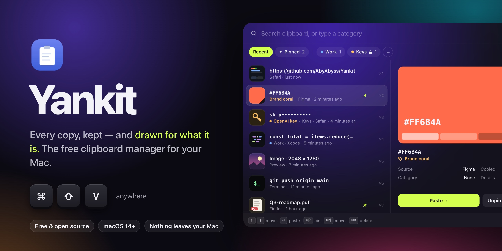
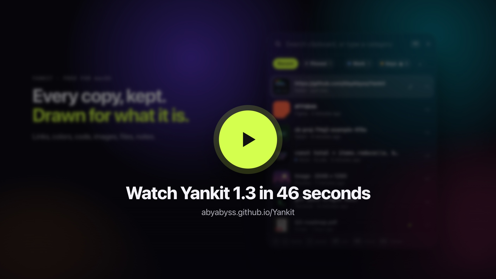
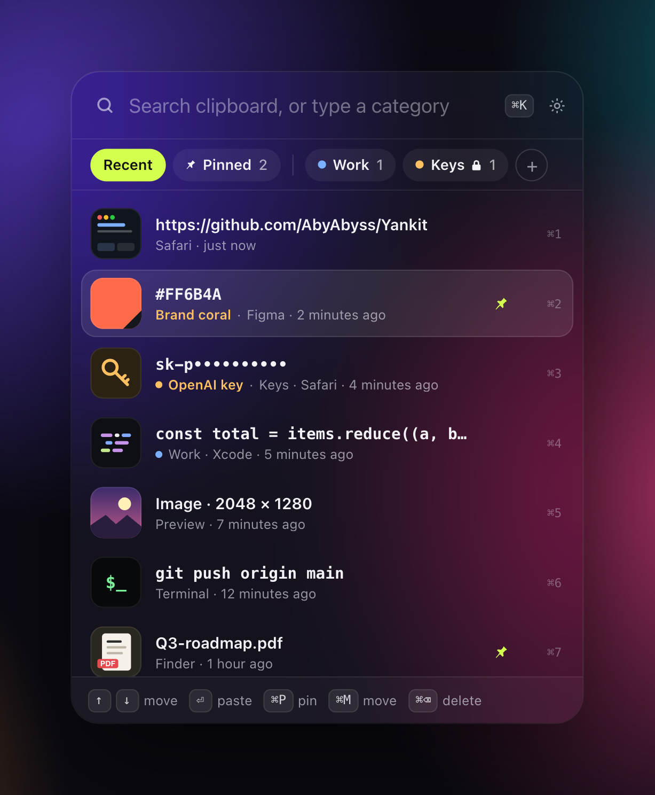
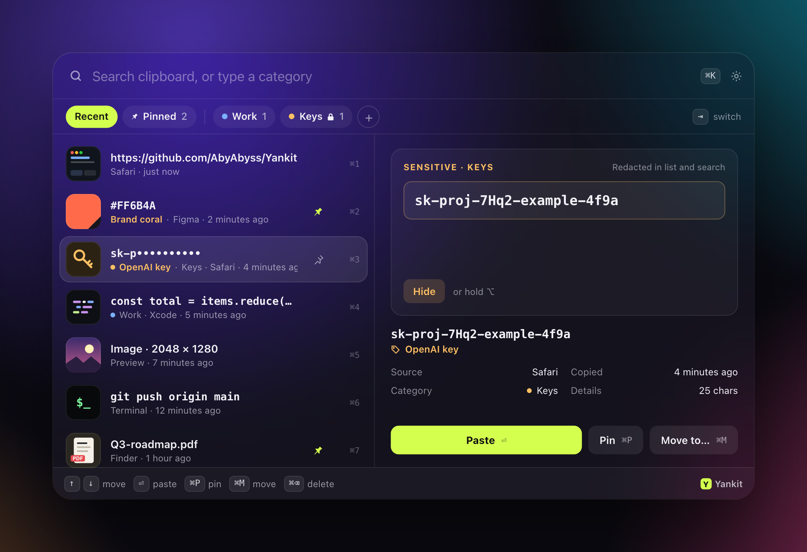
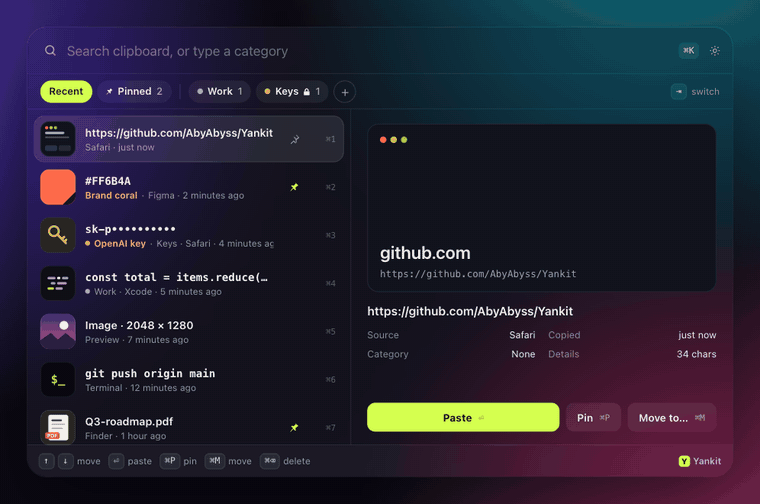
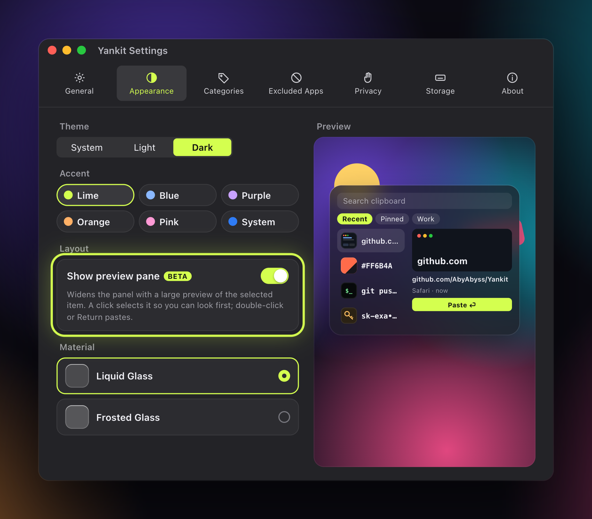
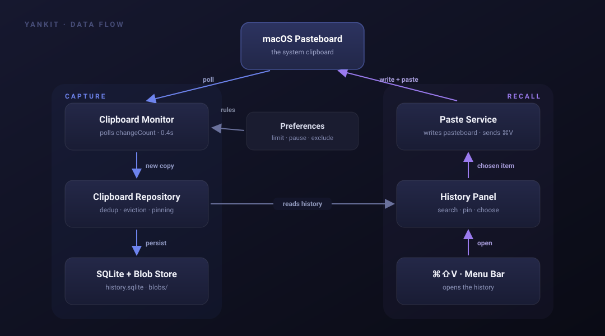

<p align="center">
  
</p>

<p align="center">
  <a href="https://github.com/AbyAbyss/Yankit/releases/latest"></a>
  
  
  
</p>

<h3 align="center">You copied it two hours ago. <b>Yankit kept it.</b></h3>

<p align="center">
  A free, open-source clipboard manager that lives in your Mac's menu bar.<br>
  Press <kbd>⌘</kbd> <kbd>⇧</kbd> <kbd>V</kbd> anywhere: search, pick, paste.
</p>

<p align="center">
  <a href="https://github.com/AbyAbyss/Yankit/releases/latest"><b>⬇&nbsp; Download for macOS</b></a> &nbsp;·&nbsp;
  <a href="https://abyabyss.github.io/Yankit"><b>Website</b></a> &nbsp;·&nbsp;
  <a href="#features">Features</a> &nbsp;·&nbsp;
  <a href="#keyboard-shortcuts">Shortcuts</a> &nbsp;·&nbsp;
  <a href="#build-from-source">Build</a>
</p>

<br>

<p align="center">
  <a href="https://abyabyss.github.io/Yankit#video">
    
  </a>
</p>

---

## Every copy, drawn for what it is

Links, colors, code, terminal commands, images, PDFs, notes — each copy gets its
own tile, so you find it by sight before you've finished typing.

<table>
  <tr>
    <td width="46%" valign="middle">
      
    </td>
    <td width="54%" valign="middle">
      <h3>🔎&nbsp; Search it. Tab through it.</h3>
      Start typing to filter instantly. <kbd>⇥</kbd> flips between <b>Recent</b>, <b>Pinned</b>, and your own colored categories — each chip shows its count.
      <h3>📌&nbsp; Keep what matters</h3>
      Pin with <kbd>⌘P</kbd>, label with <kbd>⌘L</kbd>, and move items into categories by drag and drop or <kbd>⌘M</kbd>. Pinned and categorized items are never trimmed.
      <h3>⚡&nbsp; Never touch the mouse</h3>
      <kbd>⌘1</kbd>–<kbd>⌘9</kbd> paste the first nine items straight into the app you were just in.
    </td>
  </tr>
</table>

## Secrets stay secret

Drop an API key onto a **sensitive** category and it's redacted everywhere — in
the list, in search, in the preview. Only the first few characters show (you
choose how many), and a label like *OpenAI key* tells you what it is. Hold
<kbd>⌥</kbd> to peek; let go and it's hidden again.

<p align="center">
  
</p>

## New in 1.3 — Preview <sup><code>BETA</code></sup>

Look first, paste second. Turn on **Settings → Appearance → Show preview pane**
and the panel widens with a large preview of whatever you select: a link's site, a color
with its shades, code in full, the whole image, a PDF's first page.

<p align="center">
  
</p>

With the preview on, a click selects and a double-click (or <kbd>Return</kbd>)
pastes. With it off — the default — a single click pastes, just like before.

<table>
  <tr>
    <td width="58%" valign="middle">
      
    </td>
    <td width="42%" valign="middle">
      <h3>🎨&nbsp; Your glass. Your color.</h3>
      Four materials — <b>Liquid Glass</b> (macOS 26), <b>Frosted Glass</b>, <b>Translucent</b>, and <b>Solid</b> — with adjustable opacity.
      <br><br>
      Six accents: Lime, Blue, Purple, Orange, Pink, or your system color. Light, dark, or follow the system.
      <br><br>
      A live preview shows every change before you close Settings.
    </td>
  </tr>
</table>

## Features

| | |
| --- | --- |
| 📋 **Captures everything** | Text, images, and files — automatically, as you copy. |
| 🖼 **Rich tiles** | Links, colors, code, terminal commands, images, PDFs, files, and notes each look like themselves. |
| 🗂 **Categories** | Create, rename, recolor, and reorder your own; one category per item, kept forever. |
| 🔒 **Sensitive categories** | Redacted in the list, search, and preview; hold <kbd>⌥</kbd> to peek. |
| 🏷 **Labels** | Name any item — labels show on redacted items and are searchable. |
| 📌 **Pins** | Pinned items skip the rolling limit and auto-expiry. |
| 👀 **Preview pane** <sup>beta</sup> | A large, per-kind preview of the selected item. |
| ✨ **Liquid Glass** | Native glass on macOS 26, frosted or translucent everywhere else. |
| 🎨 **Accents & themes** | Six accents, light/dark/system, four materials. |
| ⌨️ **Keyboard-first** | Every action has a shortcut; <kbd>⌘⇧V</kbd> is rebindable. |
| 🧹 **Self-tidying** | A configurable cap (default 30) trims the oldest items, with optional expiry by age. |
| ⏸ **Pause** | Silence capture for an hour, until tomorrow, or until you resume. |
| 🚫 **Per-app exclusion** | Ignore copies made in the apps you choose. |
| 🪶 **Light on memory** | SQLite plus image files on disk, not in RAM (~40 MB idle). |
| 🛡 **Private** | Skips password-manager content, stays out of Spotlight and Time Machine. No account, no sync, no telemetry — nothing leaves your Mac. |

## Keyboard shortcuts

| Shortcut | Action |
| --- | --- |
| <kbd>⌘</kbd> <kbd>⇧</kbd> <kbd>V</kbd> | Open / close the history panel (rebindable) |
| *type* | Filter the history live |
| <kbd>↑</kbd> <kbd>↓</kbd> | Move the selection |
| <kbd>Return</kbd> | Paste the selected item |
| <kbd>⌘</kbd> <kbd>1</kbd>–<kbd>9</kbd> | Paste the Nth visible item |
| <kbd>⇥</kbd> / <kbd>⇧</kbd> <kbd>⇥</kbd> | Next / previous tab |
| <kbd>⌘</kbd> <kbd>P</kbd> | Pin or unpin |
| <kbd>⌘</kbd> <kbd>L</kbd> | Label the selected item |
| <kbd>⌘</kbd> <kbd>M</kbd> | Move to a category |
| <kbd>⌘</kbd> <kbd>N</kbd> | New category |
| <kbd>⌘</kbd> <kbd>K</kbd> | Focus search |
| <kbd>⌘</kbd> <kbd>⌫</kbd> | Delete the selected item |
| hold <kbd>⌥</kbd> | Peek at a sensitive item (preview pane) |
| <kbd>Esc</kbd> | Dismiss the panel |

## Download

Grab the latest **`Yankit-<version>.dmg`** from
[**Releases**](https://github.com/AbyAbyss/Yankit/releases/latest), open it, and
drag **Yankit** into Applications. Requires macOS 14 (Sonoma) or later.

<details>
<summary><b>First launch: "macOS can't verify Yankit"</b></summary>

<br>

Yankit is a free side project and isn't notarized yet. Open **System Settings →
Privacy & Security** and click **Open Anyway**, or run:

```sh
xattr -dr com.apple.quarantine /Applications/Yankit.app
```

For one-touch paste, grant Yankit **Accessibility** access when prompted (System
Settings → Privacy & Security → Accessibility). Without it, Yankit still puts
your pick on the clipboard for a manual <kbd>⌘V</kbd>.

</details>

## How it works

Yankit lives in the menu bar — no Dock icon, no window in your way. A lightweight
monitor watches the system pasteboard and records each new copy into a local
SQLite database, with image and file payloads stored on disk so the database
stays small and fast. When you pick an item, it goes back on the pasteboard and
Yankit pastes it into wherever you were.

<p align="center">
  
</p>

Two paths, one shared clipboard: the **capture** path records what you copy, the
**recall** path puts it back. The full design is in
[ARCHITECTURE.md](ARCHITECTURE.md).

## Build from source

Requires Xcode 15+ and [XcodeGen](https://github.com/yonaskolb/XcodeGen). The
Xcode project is generated from `project.yml`, so it isn't committed:

```sh
brew install xcodegen
git clone https://github.com/AbyAbyss/Yankit.git
cd Yankit && xcodegen generate && open Yankit.xcodeproj
```

Press <kbd>⌘R</kbd> to run and <kbd>⌘U</kbd> to run the tests. A clipboard icon
appears in the menu bar.

## Releasing

The version lives in one place — `MARKETING_VERSION` in `project.yml` — and
GitHub Actions builds, tests, packages a DMG, and publishes a release for exactly
that version. Trigger it with the **Run workflow** button on the Release action,
or by pushing the matching tag:

```sh
git tag v1.3.1
git push origin v1.3.1
```

Versions follow semver (`1.3.1` patch, `1.4.0` minor, `2.0.0` major). See
**[docs/RELEASING.md](docs/RELEASING.md)** for the full guide — bump rules, local
builds, code signing, notarization, and Homebrew.

## Roadmap

- Code signing and notarization for a friction-free install
- A Homebrew cask (`brew install --cask yankit`)
- Drag items out of the history panel

## License

MIT — see [LICENSE](LICENSE). Contributions welcome.

<p align="center">
  <sub>Made by <a href="https://abyabyss.github.io/">Aby Saji</a> · <a href="https://abyabyss.github.io/Yankit">abyabyss.github.io/Yankit</a></sub>
</p>
